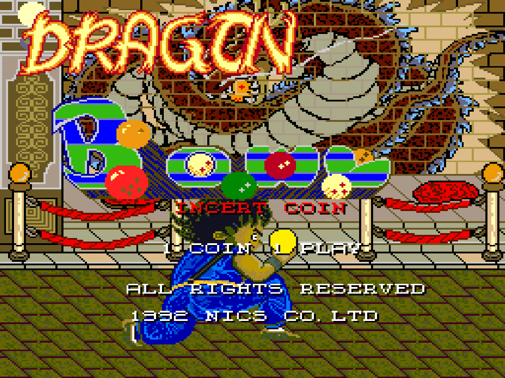
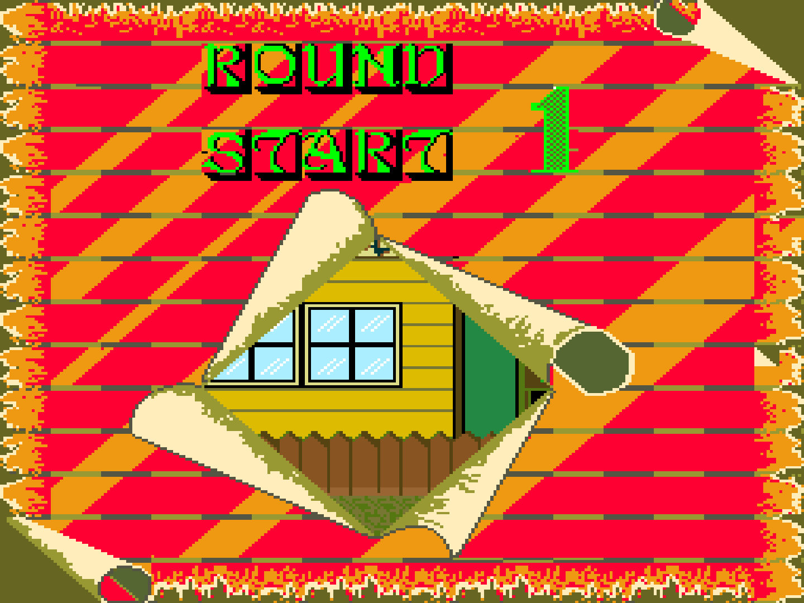
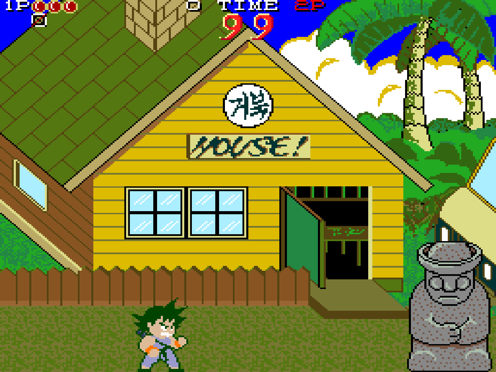

# DragonBowl — MiSTer용 드래곤 보울

[English](README.md) · 한국어 · [日本語](README.ja.md)

**드래곤 보울(Dragon Bowl)**의 MiSTer FPGA 코어입니다. 드래곤 보울은 1992년 한국의 닉스(Nics)가 만든 아케이드 게임으로, 테크모의 아케이드 《닌자 가이덴》(1988)을 무단으로 개조한 부트렉입니다. 전용 기판에서 돌아가며, 그래픽과 사운드를 새로 만들었습니다.

취미로 만든 프로젝트이며 **jotego의 공식 코어가 아닙니다**. jotego의 JTFRAME 위에서 만들었고, 그의 닌자 가이덴 코어(JTGAIDEN)를 참고했습니다.

## AI 도움

이 코어는 AI 코딩 도우미(Anthropic의 Claude, Claude Code)의 도움을 받아 개발했습니다.

## 지원 게임

| MAME 세트 | 제목 | MRA |
|---|---|---|
| `drgnbowl` | Dragon Bowl (set 1, encrypted program) | `mra/Dragon Bowl (set 1, encrypted program).mra` |
| `drgnbowla` | Dragon Bowl (set 2, unencrypted program) | `mra/_alternatives/_Dragon Bowl/Dragon Bowl (set 2, unencrypted program).mra` |

MAME처럼 set 1이 부모, set 2가 클론이라서 set 2는 `_alternatives` 아래에 있습니다. `mra/` 폴더는 SD 카드의 `_Arcade/`와 같은 구조입니다. set 1의 프로그램 롬은 주소선 두 개가 바뀌어 있는데, MRA가 블록 순서를 바로잡아서 두 세트가 같은 프로그램을 읽고 똑같이 동작합니다.

롬은 들어 있지 않습니다. 직접 가지고 계신 MAME 세트(`drgnbowl.zip`, `drgnbowla.zip`)를 `games/mame/`에 넣어 주세요.

## 스크린샷

| | |
|---|---|
|  1라운드 시작 |  1스테이지 |

## 목표: 실기처럼 동작

에뮬레이터를 그대로 따라 하는 것이 아니라 원래 기판처럼 동작하는 것이 목표입니다. 자료가 서로 다를 때는 다음 순서로 정합니다.

1. 원래 기판(실기 녹화 영상)
2. MAME의 `tecmo/gaiden.cpp` 드라이버: 게임 프로그램이 보는 부분(메모리 맵, 입출력, 인터럽트, 롬 배치)을 믿고 따릅니다.

기판의 커스텀 로직은 정체를 알 수 없는 FPGA 두 개 안에 있고 회로도도 알려져 있지 않습니다. 그래서 하드웨어 세부 사항은 대부분 MAME와, 코어 출력을 실기 영상과 비교한 결과에서 왔습니다.

## 하드웨어

| 부품 | 칩 | 구현 |
|---|---|---|
| 메인 CPU | 68000 @ 10 MHz | fx68k (`jtframe_m68k`) |
| 사운드 CPU | Z80 @ 6 MHz | T80 (`jtframe_sysz80`) |
| FM | YM2151 @ 4 MHz | `jt51` |
| ADPCM | OKI M6295 @ 1 MHz | `jt6295` |
| 영상 | 픽셀 클럭 6 MHz, 전체 384 × 264 (59.19 Hz), 표시 256 × 224 | `jtframe_vtimer` |
| 레이어 | 텍스트(8 × 8), 전경과 배경(16 × 16) | `jtframe_scroll` (JTGAIDEN과 같은 방식) |
| 스프라이트 | 16 × 16 스프라이트 256개 | `jtframe_objscan`, `jtframe_objdraw` |
| 색 | 팔레트 RAM 4096색, R/G/B 각 4비트 | 직접 만든 색 혼합기 |

## 상태

동작하는 것:

- 두 세트 모두 부팅하고 플레이됩니다: 화면, 음악, 효과음과 음성, 2인 플레이, DIP 스위치, 리셋. 플레이는 1스테이지 중반까지 확인했습니다.
- 텍스트 레이어(점수 표시줄, "DEMO GAME")가 실기 영상처럼 스프라이트 앞에 그려집니다.
- 주사율은 실기 영상에서 잰 약 59.17 Hz에 가까운 59.19 Hz입니다.
- 일부 데모 뒤의 랭킹 화면에 "DEMO GAME" 글자가 남는 것은 게임 프로그램의 동작입니다.

실기와 다른 점:

- 어트랙트 모드의 데모는 약 4초 동안 실기 영상과 같게 진행되다가 다른 흐름으로 갈라집니다. 원인은 아직 모릅니다.
- 실기는 화면 왼쪽 1~3열 정도를 가립니다. 영상으로는 정확한 열 수를 잴 수 없어서, 코어는 256열을 모두 보여 줍니다.
- 실기의 색은 CRT를 카메라로 찍은 영상밖에 없어서 정확히 비교하지 못했습니다.
- 스프라이트가 많은 장면에서 한 줄에 그리는 스프라이트 수의 한계는 실기와 비교하지 못했습니다.
- 화면 반전은 지원하지 않습니다.

## 조작

닌자 가이덴과 같은 8방향 레버와 버튼 3개입니다.

| 입력 | 동작 |
|---|---|
| 버튼 1 | 잡기 (Grab) |
| 버튼 2 | 공격 (Attack) |
| 버튼 3 | 점프 (Jump) |

DIP 스위치(기본값은 MRA에서 정하고, OSD에서 바꿀 수 있습니다): Demo Sounds, Coin A, Coin B, Difficulty, Energy, Lives.

Difficulty: 드래곤 보울은 닌자 가이덴의 DIP 스위치를 그대로 쓰는데, 테크모의 닌자 가이덴 매뉴얼에도 설정 이름이 NORMAL, TBL 1, TBL 2, TBL 3으로만 적혀 있습니다(OSD에서는 Normal, Table 1~3). 설정마다 프로그램 안의 다른 적 설정 표를 고르는데, 표의 값을 보면 Normal이 가장 쉽고 Table 3이 가장 어려운 것으로 보입니다.

## 빌드

[BUILD.md](BUILD.md)(영어)를 보세요. [jtcores](https://github.com/jotego/jtcores) 체크아웃 안에서 jotego의 `jtcore` 도구로 빌드합니다.

## 만든 사람들

- **Jose Tejada (jotego)**: JTFRAME, 그리고 이 코어의 바탕이 된 코어와 모듈: JTGAIDEN(닌자 가이덴), `jt51`, `jt6295`, `jtframe_scroll`, `jtframe_objdraw`. https://github.com/jotego/jtcores
- **Jorge Cwik (ijor)**: 68000 코어 fx68k. **Daniel Wallner**: Z80 코어 T80.
- **Alexey Melnikov (sorgelig)와 MiSTer 프로젝트**: JTFRAME이 쓰는 MiSTer 프레임워크(`sys/`).
- **MAME**: 참고 자료로 쓴 `gaiden.cpp` 드라이버(MAME 코드는 들어 있지 않습니다).
- **닉스(Nics)**: 원작 게임.

## 후원

이 코어는 무료이고 앞으로도 무료이며, 팁으로만 열리는 기능은 없습니다. 마음에 드셨다면 [Ko-fi](https://ko-fi.com/intactio)에서 커피 한 잔 사 주세요. 팁은 이 코어 작업에만 쓰이며, 게임 값이 아니고, 롬은 어떤 경우에도 제공하지 않습니다.

## 라이선스

GPLv3. [LICENSE](LICENSE)를 보세요. jtcores를 바탕으로 한 파일에는 원본 파일 이름을 적고, 원래의 저작권 표시와 GPLv3 라이선스를 유지합니다.
